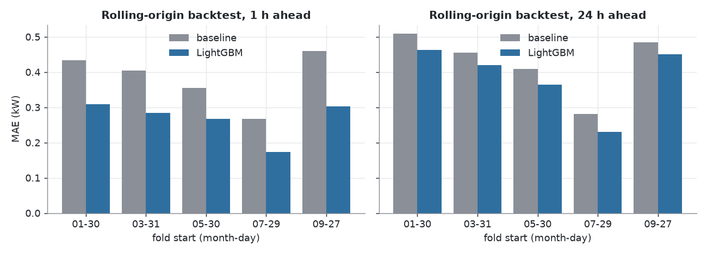
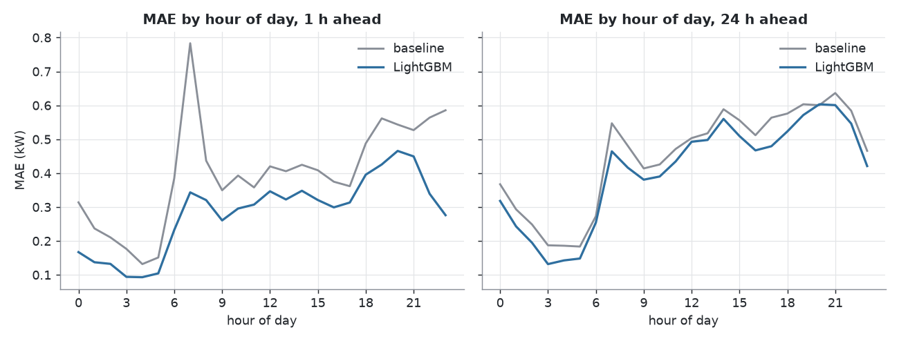
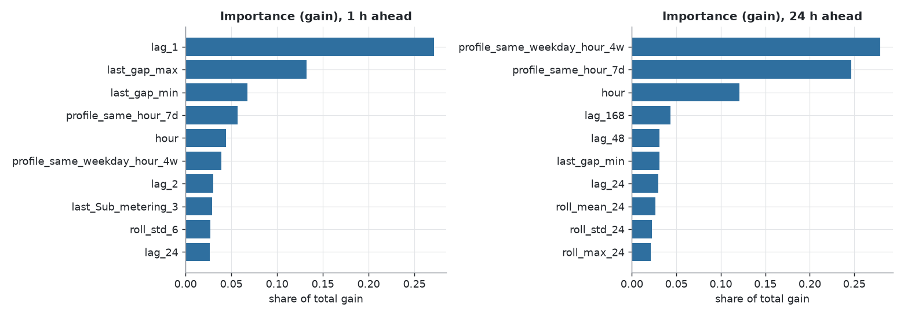
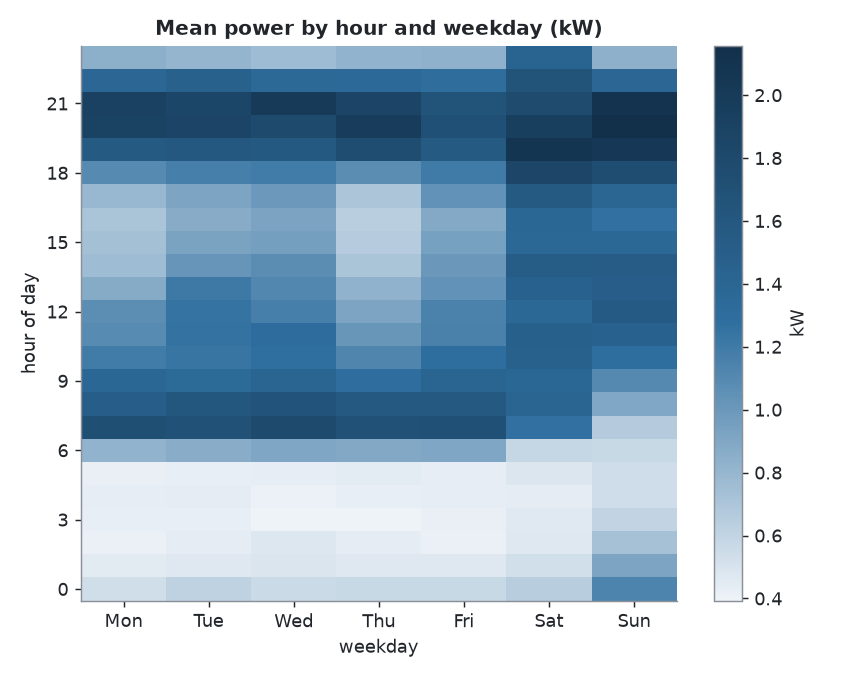
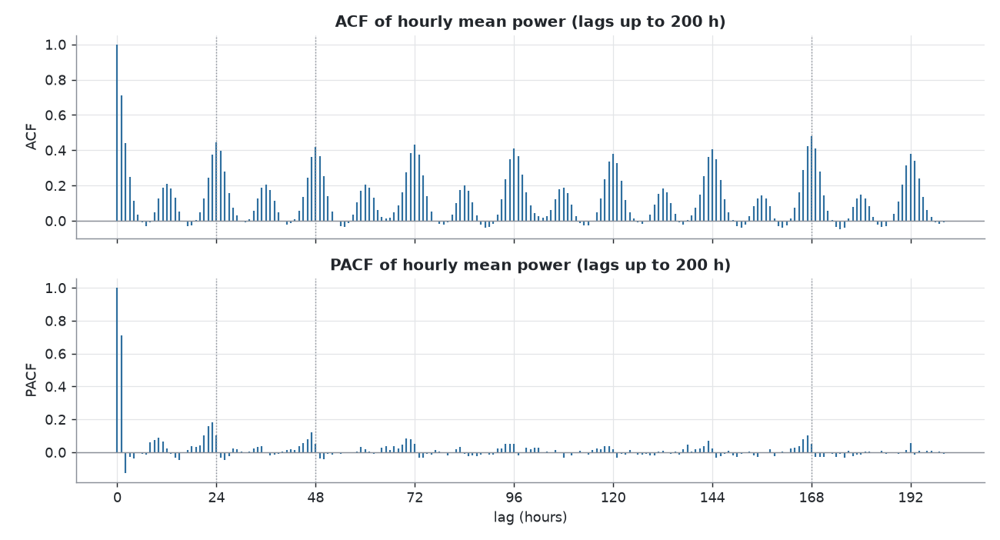
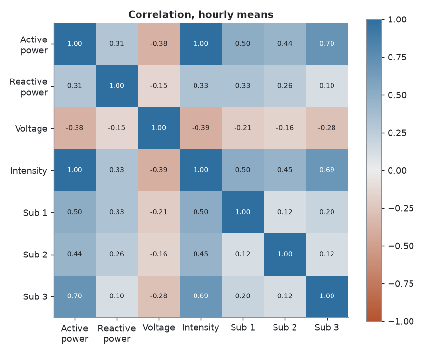
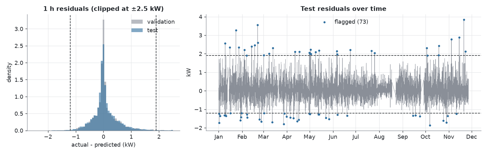

# Household electricity consumption forecasting

English | [Türkçe](README.tr.md)

> Bu çalışma, 12/2024'te ders projesi olarak yapılan ilk sürümün 2026'da yeniden ele alınmış halidir.
> (This work is a 2026 revisit of the first version, which was done as a course project in 12/2024. The 2024 code and reports are kept in `legacy/` for reference. The original state of the repository is also available at the `v1-2024` tag.)

## Problem

Forecast the hourly average active power (kW) of a single French household, using only information available at forecast time:

- **1 hour ahead**: the value of the next hour.
- **24 hours ahead**: day-ahead forecast.

The target is the mean power over the whole hour (`resample('h').mean()`), not the single measurement at minute :00.

Metrics: MAE (kW), RMSE, R², and the percent MAE improvement over the strongest naive baseline.

## Data

UCI "Individual household electric power consumption" (Hebrail and Berard), one household, one measurement per minute, 2006-12-16 17:24 to 2010-11-26 21:02, 2,075,259 rows. DOI: https://doi.org/10.24432/C58K54

Columns: Date, Time, Global_active_power (target), Global_reactive_power, Voltage, Global_intensity, Sub_metering_1/2/3.

Split by time, never at random:

| Part | Period |
|---|---|
| Train | 2006-12 to 2009-06 |
| Validation | 2009-07 to 2009-12 |
| Test | 2010-01 to 2010-11 |

All model selection and tuning used the validation period only. The test period was scored once, at the end.

## Data quality findings

- The original file has **25,979 missing minutes (1.25%)** in 71 blocks. 15 blocks of 10 minutes or more account for 25,897 of them. The longest gap is 7,226 minutes (about 5 days), 2010-08-17 to 2010-08-22.
- The minute file used in the 2024 project has no missing values. Its gaps were **filled with one constant row, the column means** (1.0916 kW for active power). This was checked by comparing both files: on the minutes that were really measured, the two files are identical.
- A heuristic that flags runs of 10 or more identical rows found 16 blocks. Compared with the original, it recovers 99.7% of the missing minutes (25,897 of 25,979) with 98.5% precision. One flagged block (2008-10-06, 400 minutes, constant 0.36 kW and 241.18 V) is real data in the original file. It was kept, and its cause is unknown (possibly a stuck logger).
- This project works from the original file. Gaps stay NaN and nothing is filled.
- Hourly series: 34,589 hours on a gapless hourly index. An hour with fewer than 45 valid minutes is set to NaN. 34,151 hours (98.7%) are valid.

## Problems of the 2024 approach, with evidence

The 2024 project took the :00 row of each hour, split randomly 70/15/15, trained an unscaled Keras ANN (64-32-1) on 11 features including same-instant measurements, and evaluated on the validation set only.

1. **Leakage from same-instant measurements.** On hourly means, `Global_intensity` correlates 0.9994 with the target (power is roughly voltage times current; voltage x intensity gives 0.9996). The sum of the sub-meters correlates 0.85. Legitimate past values correlate much less: 0.71 (1 h ago), 0.44 (24 h ago), 0.46 (168 h ago).
2. **The :00 snapshot is a poor target.** Its correlation with the true hourly mean is 0.78, and the two differ by more than 0.5 kW in 28% of hours.
3. **Unscaled inputs.** The validation MAE jumped 0.448 kW on average between epochs, against 0.001 kW after scaling. Across three seeds the old setup gave test MAE from 0.04 to 0.46 kW.

The 2024 setup was re-run and changed one thing at a time. Same ANN, old hourly file, test MAE as mean and standard deviation over 3 seeds:

| Setup | Test MAE (kW) | Test R² |
|---|---|---|
| A. 2024 setup (random split, unscaled, 11 features) | 0.263 +/- 0.172 | 0.905 |
| B. + scaling | 0.028 +/- 0.002 | 0.998 |
| C. + chronological split | 0.028 +/- 0.004 | 0.998 |
| D1. minus `Global_intensity` | 0.279 +/- 0.020 | 0.822 |
| D2. minus sub-meters as well | 0.588 +/- 0.031 | 0.298 |
| D3. minus all same-instant measurements (calendar only) | 0.582 +/- 0.005 | 0.193 |
| Reference: always predict the training mean | 0.722 | -0.005 |

Reading: the score was inflated by same-instant columns, not by the split. With those columns present, a chronological split changed nothing. A control (calendar features only) showed a smaller effect of the random split than expected: ANN test R² 0.244 with a random split against 0.193 with a chronological one, and LightGBM test R² 0.366 against 0.258 (MAE gain over the training mean 29.4% against 24.0%). The random split is still the wrong protocol for a forecast, but in this setup it explains a smaller part of the inflation than the leaked columns do. These rows use the old hourly file, so they are not comparable with the results below.

## Method

**Features** (`src/features.py`), all computed from data available at forecast time (shifted by at least the horizon):

| Group | Content | Count (1 h / 24 h) |
|---|---|---|
| Calendar | hour, weekday, month, day of year, weekend | 5 / 5 |
| Lags | t-1, t-2, t-3, t-24, t-48, t-168 (only lags of at least the horizon) | 6 / 3 |
| Rolling and profiles | mean, std, max over 6, 24, 168 h; same hour over the last 7 days; same weekday and hour over the last 4 weeks | 11 / 11 |
| Holidays | French public holiday, day before, day after | 3 / 3 |
| Sub-hour and meters | max, min, std of the last known hour; the three sub-meters of the last known hour | 6 / 6 |

Rolling windows need at least half of the window valid. Missing values are left as NaN. `tests/test_no_leakage.py` corrupts every measurement after the forecast origin at random hours and checks that the features of the forecast hour do not change. It runs after each cumulative feature group, for both horizons, and a control confirms that it catches a deliberately leaky feature.

**Baselines** (`src/baselines.py`): t-1 (1 h only), t-24, t-168, mean of the same hour over the last 7 days, mean of the same weekday and hour over the last 4 weeks. All models and baselines are scored on the same hours, those where the target and every baseline are defined.

**Models** (`src/models.py`): Ridge, LightGBM, HistGradientBoosting, a scaled Keras ANN, and an equal-weight ensemble. LightGBM used 25 random trials (num_leaves, learning rate, min child samples, feature fraction, L2, objective L2, L1 or Huber) with early stopping on validation MAE. Selection by validation MAE. The final model is refitted on train and validation with the parameters and number of trees chosen on validation, and scored once on test.

## Results

### Test period (2010-01 to 2010-11), one evaluation

| Horizon | Reference baseline (chosen on validation) | Baseline MAE | LightGBM MAE | LightGBM RMSE | LightGBM R² | MAE improvement |
|---|---|---|---|---|---|---|
| 1 hour | t-1 | 0.400 | **0.283** | 0.447 | 0.663 | **29.3%** |
| 24 hours | mean of the same hour, last 7 days | 0.449 | **0.408** | 0.599 | 0.395 | **9.2%** |

Scored on 6,069 of the 7,623 valid test hours (80%). The rest have a baseline that is undefined because of gaps in the history. Scoring the model on all 7,623 valid hours gives MAE 0.289 (1 h) and 0.420 (24 h). On validation the improvements were 31.6% and 11.1%.

### Model comparison on validation

| Model | 1 h MAE | 1 h improvement | 24 h MAE | 24 h improvement |
|---|---|---|---|---|
| Best baseline | 0.412 | | 0.443 | |
| Ridge, calendar + lags | 0.359 | 12.8% | 0.462 | -4.3% |
| Ridge, all features | 0.340 | 17.5% | 0.443 | -0.1% |
| LightGBM | **0.282** | 31.6% | **0.394** | 11.1% |
| HistGradientBoosting | 0.287 | 30.5% | 0.397 | 10.3% |
| ANN (3 seeds, untuned) | 0.298 | 27.8% | 0.409 | 7.6% |
| Ensemble, best 3 | 0.283 | 31.4% | 0.393 | 11.3% |

Ridge did not beat the baseline at 24 hours. The ANN did not beat the boosting models in this setup. The ensemble gave no clear gain over LightGBM, so LightGBM was kept. Differences of a few thousandths of a kW between the top models are probably noise; no confidence intervals were computed. In the random search the L1 objective was best at both horizons.

### Rolling-origin backtest (5 folds of 60 days)

Each fold trains on everything before the fold and forecasts the next 60 days with the fixed parameters. The folds cover 2010-01-30 to 2010-11-26, so they lie inside the test period: they show robustness across seasons, not independent confirmation.

| Fold | Period | 1 h MAE (model / baseline) | 24 h MAE (model / baseline) |
|---|---|---|---|
| 1 | 01-30 to 03-31 | 0.309 / 0.433 | 0.462 / 0.509 |
| 2 | 03-31 to 05-30 | 0.284 / 0.405 | 0.420 / 0.456 |
| 3 | 05-30 to 07-29 | 0.267 / 0.355 | 0.365 / 0.409 |
| 4 | 07-29 to 09-27 | 0.173 / 0.267 | 0.230 / 0.280 |
| 5 | 09-27 to 11-26 | 0.302 / 0.460 | 0.450 / 0.485 |

The model beat the baseline in 5 of 5 folds at both horizons (1 h: 24.8% to 35.3%; 24 h: 7.1% to 17.8%).



### Error by hour of day and feature importance

Errors are lowest at night (MAE about 0.09 to 0.15 kW at 03:00 to 05:00) and highest in the evening peak (19:00 to 21:00: 0.43 to 0.47 kW at 1 h, 0.57 to 0.60 kW at 24 h). At 24 hours the model is no better than the baseline at 20:00. The most important features by gain are `lag_1`, `last_gap_max` and `last_gap_min` at 1 h, and the two same-hour profiles and the hour of day at 24 h.




### Ablation (validation, feature groups added in order)

| Features | 1 h MAE | 1 h improvement | 24 h MAE | 24 h improvement |
|---|---|---|---|---|
| Calendar | 0.435 | -5.6% | 0.433 | 2.2% |
| + lags | 0.313 | 24.1% | 0.407 | 8.0% |
| + rolling and profiles | 0.309 | 25.1% | 0.394 | 10.9% |
| + holidays | 0.307 | 25.5% | 0.393 | 11.3% |
| + sub-hour and meters | 0.282 | 31.6% | 0.394 | 11.1% |

Lags give the largest jump. The sub-hour group helps only at 1 hour. The holiday group changes MAE by 0.001 to 0.002 kW, which cannot be separated from noise. The ablation depends on the order of the groups, and each run chose its own number of trees by early stopping.

## What the data looks like





- Strong daily, weekly and seasonal rhythm: mean power in December 1.49 kW against 0.57 kW in August. ACF peaks at 24 and 168 hours (0.45 and 0.48).
- The distribution is right-skewed (skewness 1.30; mean 1.09 kW, median 0.80 kW) and bimodal on a log axis.
- No trend: the January to November mean was 1.07, 1.05, 1.05, 1.06 kW for 2007 to 2010. The day-to-day spread was smaller in later years.
- Some Augusts show a nearly empty house (for example 25 days in 2008 with daily mean below 0.4 kW).
- STL decomposition (period 24) gives a seasonal strength of 0.39 and a trend strength of 0.22, so a large part of the variance is not explained by calendar and trend.

## Anomaly flags (exploratory)

Thresholds are the 0.5% and 99.5% quantiles of the validation residuals of the 1-hour model (-1.20 and +1.90 kW), fixed before the test period was scored. On the test period 73 of 7,623 hours (0.96%, approximate 95% interval 0.76% to 1.20% assuming independent hours) fall outside, against 1.00% on validation by construction. The residual distribution on test is close to validation, so there is no evidence of distribution shift in the residuals. 71 of the 73 flagged hours are isolated hours.



The flagged hours are hours with unexpected consumption relative to the model. **It is not known why they are unusual.** They are not confirmed faults or events, and no labels exist to check them.

## Limitations

- One household and about four years of data. Results may not transfer to other homes.
- The gain at 24 hours is modest (9.2% on test, R² 0.40). A large part of the consumption is not predictable from the available history.
- No weather data and no occupancy information.
- One test period and one run. No confidence intervals. Hyperparameters and the number of trees were chosen on validation, so validation scores are slightly optimistic. The ANN and HistGradientBoosting were tuned little, so "the ANN did not win" holds for this setup only.
- 20% of the valid test hours are not scored because a baseline is undefined there (strict rule, no filling), and about 12 days of test data are missing in the source.
- Anomaly flags are not validated events.
- The 400-minute constant block on 2008-10-06 was kept as measured data.

## Project layout

```
src/
  data_quality.py   missing blocks and the identical-row heuristic
  hourly.py         minute data to hourly series
  eda.py            exploratory figures and numbers
  legacy_repro.py   2024 setup re-run, one change at a time
  split_check.py    random vs chronological split with LightGBM
  baselines.py      naive baselines
  features.py       leakage-safe features
  models.py         Ridge, LightGBM, HistGB, ANN, ensemble
  evaluate.py       split dates and metrics
  final_eval.py     test evaluation, backtest, importance, ablation
  anomaly.py        residual-based anomaly flags
tests/              leakage and baseline tests
legacy/             2024 project, reference only
docs/figures/       figures used in this README
```

## How to run

Python 3.12 is assumed. Docker and a single-command pipeline are not provided yet; each step is a module run.

```bash
python3 -m venv .venv
.venv/bin/pip install -r requirements.txt
mkdir -p outputs/figures outputs/metrics outputs/models data/interim
```

Place the original file at `data/raw/household_power_consumption.txt`. Steps 1 and 4 also need the 2024 minute file and the old hourly file (`electricity_data.csv`, `hourly_electricity_data.csv`) unzipped to `data/interim/extracted/ModelDatasets/`. They are not part of this repository (the 2024 data is the `ModelDatasets.zip` file at the `v1-2024` tag).

```bash
D="--data-dir data"
.venv/bin/python -m src.data_quality $D --out-dir outputs/metrics
.venv/bin/python -m src.hourly $D --out-dir outputs/metrics
.venv/bin/python -m src.eda $D --out-dir outputs
.venv/bin/python -m src.legacy_repro $D --out-dir outputs/metrics --seeds 3
.venv/bin/python -m src.legacy_repro $D --out-dir outputs/metrics --seeds 3 --only E_D3_but_random_split --tag _control
.venv/bin/python -m src.split_check $D --out-dir outputs/metrics
.venv/bin/python -m src.baselines $D --out-dir outputs/metrics
.venv/bin/python -m src.features $D --out-dir outputs/metrics
.venv/bin/python -m pytest -q tests
.venv/bin/python -m src.models $D --out-dir outputs
.venv/bin/python -m src.final_eval $D --out-dir outputs      # scores the test period; add --dry-run to use validation instead
.venv/bin/python -m src.anomaly $D --out-dir outputs
```

Data paths are always command line arguments. `data/` and `outputs/` are not tracked by git. Random seeds are fixed (LightGBM `random_state=0`, ANN seeds 0 to 2). The numbers in this README come from one run on one machine and were not re-verified on another.
