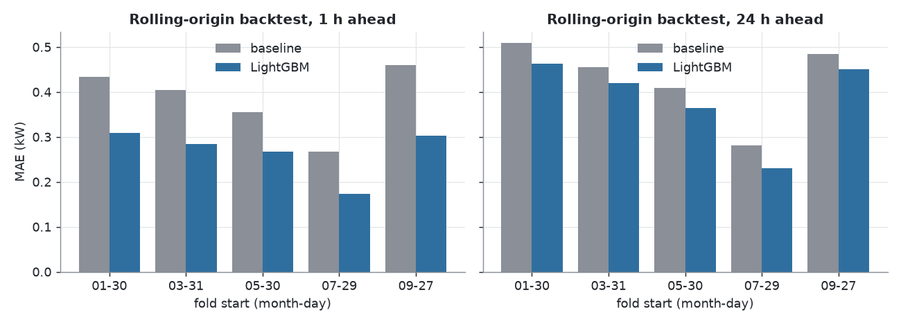
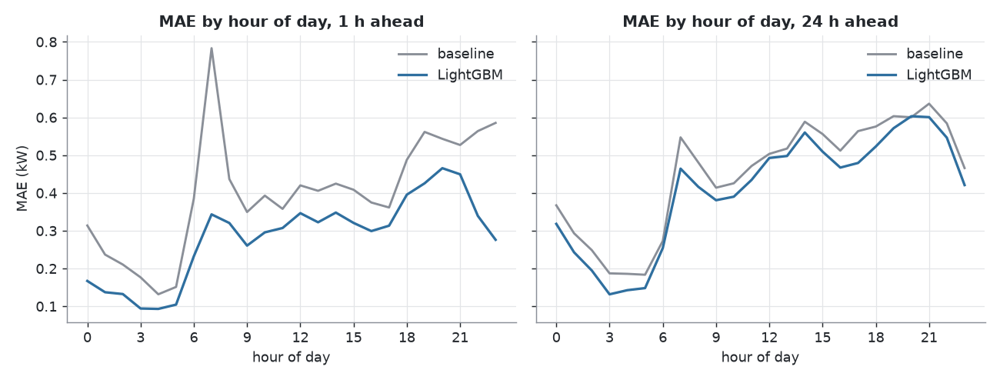
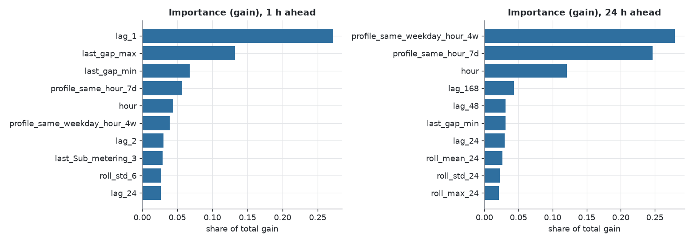
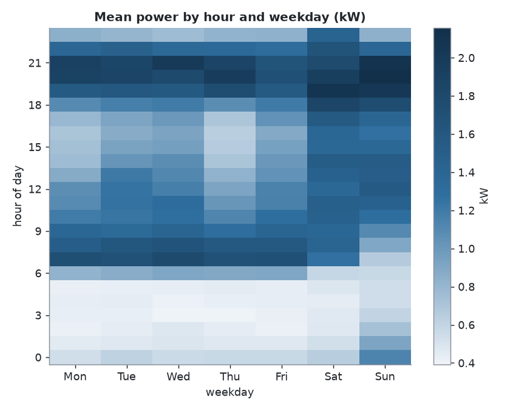
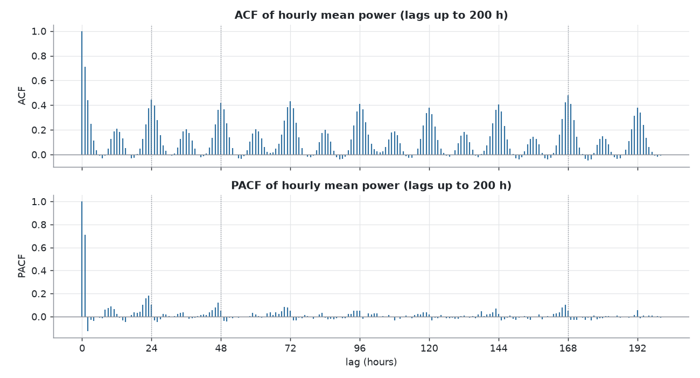
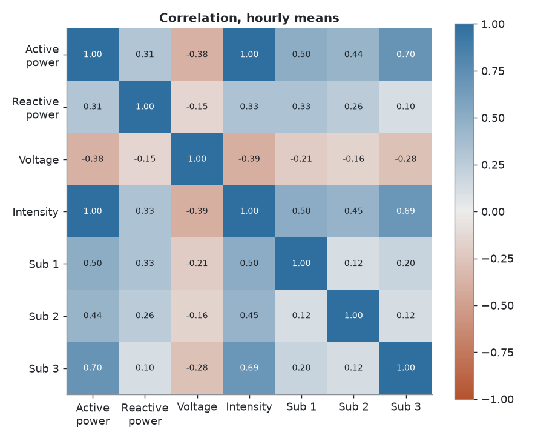
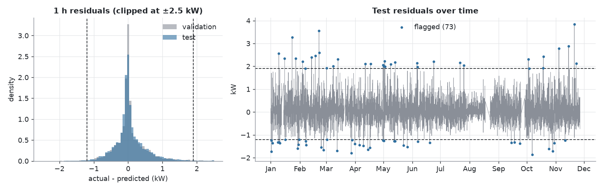

# Ev elektrik tüketimi tahmini

[English](README.md) | Türkçe

> Bu çalışma, 12/2024'te ders projesi olarak yapılan ilk sürümün 2026'da yeniden ele alınmış halidir. Eski sürümün kodu ve raporları referans olarak `legacy/` klasöründe durur. Eski sürümün olduğu hali `v1-2024` etiketinde de bulunur.

## Problem

Fransa'daki tek bir evin saatlik ortalama aktif gücünü (kW), yalnızca tahmin anında bilinen bilgiyle tahmin etmek:

- **1 saat sonrası**: bir sonraki saatin değeri.
- **24 saat sonrası**: gün öncesi tahmin.

Hedef, saatin tamamının ortalama gücüdür (`resample('h').mean()`), saatin :00 anındaki tek ölçüm değildir.

Metrikler: MAE (kW), RMSE, R² ve en güçlü basit baseline'a göre yüzde MAE iyileşmesi.

## Veri

UCI "Individual household electric power consumption" (Hebrail ve Berard). Tek bir ev, dakikada bir ölçüm, 2006-12-16 17:24 ile 2010-11-26 21:02 arası, 2.075.259 satır. DOI: https://doi.org/10.24432/C58K54

Sütunlar: Date, Time, Global_active_power (hedef), Global_reactive_power, Voltage, Global_intensity, Sub_metering_1/2/3.

Bölme zamana göre yapıldı, hiçbir zaman rastgele değil:

| Bölüm | Dönem |
|---|---|
| Eğitim | 2006-12 ile 2009-06 |
| Validation | 2009-07 ile 2009-12 |
| Test | 2010-01 ile 2010-11 |

Model seçimi ve ayarların hepsi yalnızca validation döneminde yapıldı. Test dönemi en sonda, tek sefer ölçüldü.

## Veri kalitesi bulguları

- Orijinal dosyada 71 blok halinde **25.979 eksik dakika (%1,25)** var. 10 dakika ve üzeri 15 blok, bunların 25.897'sini oluşturuyor. En uzun boşluk 7.226 dakika (yaklaşık 5 gün), 2010-08-17 ile 2010-08-22 arası.
- 2024 projesinde kullanılan dakikalık dosyada hiç eksik değer yok. Boşluklar **tek bir sabit satırla, yani sütun ortalamalarıyla doldurulmuş** (aktif güç için 1,0916 kW). Bu, iki dosya karşılaştırılarak doğrulandı: gerçekten ölçülmüş dakikalarda iki dosya birebir aynı.
- 10 veya daha fazla birebir aynı satırdan oluşan blokları arayan bir sezgisel yöntem 16 blok buldu. Orijinal dosyayla karşılaştırınca eksik dakikaların %99,7'sini (25.979 içinden 25.897) %98,5 doğrulukla yakalıyor. İşaretlenen bloklardan biri (2008-10-06, 400 dakika, sabit 0,36 kW ve 241,18 V) orijinal dosyada gerçek veri. O blok ölçülmüş veri olarak bırakıldı, sebebi bilinmiyor (kayıt cihazı takılmış olabilir).
- Bu proje orijinal dosyayla çalışır. Boşluklar NaN kalır, hiçbir şey doldurulmaz.
- Saatlik seri: aralıksız saatlik indekste 34.589 saat. 45 dakikadan az geçerli ölçümü olan saat NaN yapılır. 34.151 saat (%98,7) geçerlidir.

## 2024 yaklaşımının sorunları ve kanıtları

2024 projesi her saatin :00 satırını almış, %70/15/15 rastgele bölmüş, aynı anın ölçümlerini de içeren 11 özellikle ölçeksiz bir Keras ANN (64-32-1) eğitmiş ve yalnızca validation kümesinde değerlendirmişti.

1. **Aynı anın ölçümlerinden sızıntı.** Saatlik ortalamalarda `Global_intensity` hedefle 0,9994 korele (güç yaklaşık voltaj çarpı akımdır, voltaj x akım ile korelasyon 0,9996). Alt sayaçların toplamı 0,85 korele. Meşru geçmiş değerlerin korelasyonu çok daha düşük: 0,71 (1 saat önce), 0,44 (24 saat önce), 0,46 (168 saat önce).
2. **:00 anı kötü bir hedef.** Gerçek saatlik ortalamayla korelasyonu 0,78, saatlerin %28'inde ikisi arasındaki fark 0,5 kW'tan büyük.
3. **Ölçeksiz girdiler.** Validation MAE'si epoch'lar arasında ortalama 0,448 kW zıpladı, ölçeklemeden sonra bu 0,001 kW. Üç seed boyunca eski kurulum 0,04 ile 0,46 kW arasında test MAE'si verdi.

2024 kurulumu yeniden çalıştırıldı ve her seferinde tek bir şey değiştirildi. Aynı ANN, eski saatlik dosya, test MAE'si 3 seed üzerinden ortalama ve standart sapma olarak:

| Kurulum | Test MAE (kW) | Test R² |
|---|---|---|
| A. 2024 kurulumu (rastgele bölme, ölçeksiz, 11 özellik) | 0,263 +/- 0,172 | 0,905 |
| B. + ölçekleme | 0,028 +/- 0,002 | 0,998 |
| C. + kronolojik bölme | 0,028 +/- 0,004 | 0,998 |
| D1. `Global_intensity` çıkarıldı | 0,279 +/- 0,020 | 0,822 |
| D2. alt sayaçlar da çıkarıldı | 0,588 +/- 0,031 | 0,298 |
| D3. aynı anın tüm ölçümleri çıkarıldı (sadece takvim) | 0,582 +/- 0,005 | 0,193 |
| Referans: her zaman eğitim ortalamasını tahmin et | 0,722 | -0,005 |

Yorum: skoru şişiren şey bölme değil, aynı anın sütunlarıydı. O sütunlar varken kronolojik bölme hiçbir şeyi değiştirmedi. Bir kontrol (sadece takvim özellikleri) rastgele bölmenin etkisinin beklenenden küçük olduğunu gösterdi: rastgele bölmede ANN test R²'si 0,244, kronolojik bölmede 0,193; LightGBM için 0,366 ve 0,258 (eğitim ortalamasına göre MAE kazancı %29,4 ve %24,0). Rastgele bölme bir tahmin için yine yanlış protokol, ama bu kurulumda şişirmenin daha küçük kısmını açıklıyor, daha büyük kısmını sızdıran sütunlar açıklıyor. Bu satırlar eski saatlik dosyayı kullandığı için aşağıdaki sonuçlarla kıyaslanamaz.

## Yöntem

**Özellikler** (`src/features.py`), hepsi tahmin anında bilinen veriden hesaplanır (en az ufuk kadar kaydırılır):

| Grup | İçerik | Sayı (1 saat / 24 saat) |
|---|---|---|
| Takvim | saat, haftanın günü, ay, yılın günü, hafta sonu | 5 / 5 |
| Gecikmeler | t-1, t-2, t-3, t-24, t-48, t-168 (yalnızca ufuk kadar veya daha büyük olanlar) | 6 / 3 |
| Yuvarlanan istatistik ve profiller | 6, 24, 168 saatte ortalama, std, max; son 7 günün aynı saati; son 4 haftanın aynı gün ve saati | 11 / 11 |
| Tatil | Fransa resmi tatili, bir önceki gün, bir sonraki gün | 3 / 3 |
| Alt-saat ve sayaç | son bilinen saatin max, min, std değeri; son bilinen saatin üç alt sayacı | 6 / 6 |

Yuvarlanan pencerelerde pencerenin en az yarısı geçerli olmalıdır. Eksik değerler NaN olarak bırakılır. `tests/test_no_leakage.py`, rastgele saatlerde tahmin anından sonraki tüm ölçümleri bozar ve tahmin edilen saatin özelliklerinin değişmediğini kontrol eder. Her birikimli özellik grubundan sonra, iki ufuk için çalışır. Bir kontrol testi, kasıtlı olarak sızıntılı bir özelliği yakaladığını doğrular.

**Baseline'lar** (`src/baselines.py`): t-1 (yalnızca 1 saat), t-24, t-168, son 7 günün aynı saat ortalaması, son 4 haftanın aynı gün ve saat ortalaması. Tüm modeller ve baseline'lar aynı saatlerde değerlendirilir: hedefin ve tüm baseline'ların tanımlı olduğu saatler.

**Modeller** (`src/models.py`): Ridge, LightGBM, HistGradientBoosting, ölçekli Keras ANN ve eşit ağırlıklı topluluk. LightGBM için 25 rastgele deneme yapıldı (num_leaves, öğrenme oranı, min child samples, feature fraction, L2, kayıp L2, L1 veya Huber), validation MAE üzerinden early stopping ile. Seçim validation MAE'ye göre. Nihai model, validation'da seçilen parametreler ve ağaç sayısıyla eğitim ve validation birlikte kullanılarak yeniden eğitilir ve test'te tek sefer ölçülür.

## Sonuçlar

### Test dönemi (2010-01 ile 2010-11), tek ölçüm

| Ufuk | Referans baseline (validation'da seçildi) | Baseline MAE | LightGBM MAE | LightGBM RMSE | LightGBM R² | MAE iyileşmesi |
|---|---|---|---|---|---|---|
| 1 saat | t-1 | 0,400 | **0,283** | 0,447 | 0,663 | **%29,3** |
| 24 saat | son 7 günün aynı saat ortalaması | 0,449 | **0,408** | 0,599 | 0,395 | **%9,2** |

7.623 geçerli test saatinin 6.069'unda (%80) ölçüldü. Geri kalanında, geçmişteki boşluklar yüzünden bir baseline tanımsız. Model 7.623 geçerli saatin tamamında ölçülünce MAE 0,289 (1 saat) ve 0,420 (24 saat) çıkıyor. Validation'da iyileşmeler %31,6 ve %11,1 idi.

### Validation'da model karşılaştırması

| Model | 1 saat MAE | 1 saat iyileşme | 24 saat MAE | 24 saat iyileşme |
|---|---|---|---|---|
| En iyi baseline | 0,412 | | 0,443 | |
| Ridge, takvim + gecikme | 0,359 | %12,8 | 0,462 | %-4,3 |
| Ridge, tüm özellikler | 0,340 | %17,5 | 0,443 | %-0,1 |
| LightGBM | **0,282** | %31,6 | **0,394** | %11,1 |
| HistGradientBoosting | 0,287 | %30,5 | 0,397 | %10,3 |
| ANN (3 seed, ayarsız) | 0,298 | %27,8 | 0,409 | %7,6 |
| Topluluk, en iyi 3 | 0,283 | %31,4 | 0,393 | %11,3 |

Ridge 24 saatte baseline'ı geçemedi. ANN bu kurulumda boosting modellerini geçemedi. Topluluk LightGBM'e göre belirgin bir kazanç getirmedi, bu yüzden LightGBM tutuldu. En iyi modeller arasındaki binde birkaç kW'lık farklar büyük olasılıkla gürültüdür, güven aralığı hesaplanmadı. Rastgele aramada her iki ufukta da en iyi kayıp L1 oldu.

### Rolling-origin backtest (5 kıvrım × 60 gün)

Her kıvrımda model, kıvrımdan önceki tüm veriyle eğitilir ve sabit parametrelerle sonraki 60 günü tahmin eder. Kıvrımlar 2010-01-30 ile 2010-11-26 arasını kapsıyor, yani test döneminin içinde: bağımsız bir doğrulama değil, mevsimler arası sağlamlık göstergesidir.

| Kıvrım | Dönem | 1 saat MAE (model / baseline) | 24 saat MAE (model / baseline) |
|---|---|---|---|
| 1 | 01-30 ile 03-31 | 0,309 / 0,433 | 0,462 / 0,509 |
| 2 | 03-31 ile 05-30 | 0,284 / 0,405 | 0,420 / 0,456 |
| 3 | 05-30 ile 07-29 | 0,267 / 0,355 | 0,365 / 0,409 |
| 4 | 07-29 ile 09-27 | 0,173 / 0,267 | 0,230 / 0,280 |
| 5 | 09-27 ile 11-26 | 0,302 / 0,460 | 0,450 / 0,485 |

Model her iki ufukta da 5 kıvrımın 5'inde baseline'ı geçti (1 saat: %24,8 ile %35,3; 24 saat: %7,1 ile %17,8).



### Günün saatine göre hata ve özellik önemi

Hata en çok gece düşük (saat 03:00 ile 05:00 arasında MAE yaklaşık 0,09 ile 0,15 kW), akşam tepesinde en yüksek (19:00 ile 21:00: 1 saatte 0,43 ile 0,47 kW, 24 saatte 0,57 ile 0,60 kW). 24 saat ufkunda model saat 20:00'de baseline'dan daha iyi değil. Gain'e göre en önemli özellikler 1 saatte `lag_1`, `last_gap_max` ve `last_gap_min`, 24 saatte iki aynı-saat profili ve günün saati.




### Ablasyon (validation, özellik grupları sırayla eklendi)

| Özellikler | 1 saat MAE | 1 saat iyileşme | 24 saat MAE | 24 saat iyileşme |
|---|---|---|---|---|
| Takvim | 0,435 | %-5,6 | 0,433 | %2,2 |
| + gecikmeler | 0,313 | %24,1 | 0,407 | %8,0 |
| + yuvarlanan ve profiller | 0,309 | %25,1 | 0,394 | %10,9 |
| + tatil | 0,307 | %25,5 | 0,393 | %11,3 |
| + alt-saat ve sayaç | 0,282 | %31,6 | 0,394 | %11,1 |

En büyük sıçramayı gecikmeler veriyor. Alt-saat grubu yalnızca 1 saatte işe yarıyor. Tatil grubu MAE'yi 0,001 ile 0,002 kW değiştiriyor, bu gürültüden ayırt edilemez. Ablasyon grupların sırasına bağlı ve her koşuda ağaç sayısı early stopping ile ayrıca seçildi.

## Veri neye benziyor





- Güçlü günlük, haftalık ve mevsimsel bir ritim var: Aralık'ta ortalama güç 1,49 kW, Ağustos'ta 0,57 kW. ACF'de 24 ve 168. saatte tepeler görülüyor (0,45 ve 0,48).
- Dağılım sağa çarpık (çarpıklık 1,30; ortalama 1,09 kW, medyan 0,80 kW) ve log ekseninde iki tepeli.
- Trend yok: 2007 ile 2010 için Ocak-Kasım ortalamaları 1,07, 1,05, 1,05, 1,06 kW. Günden güne yayılım sonraki yıllarda daha küçük.
- Bazı Ağustos'larda ev neredeyse boş (örneğin 2008'de günlük ortalamanın 0,4 kW altında olduğu 25 gün).
- STL ayrıştırması (periyot 24) mevsimsellik gücünü 0,39, trend gücünü 0,22 veriyor. Yani varyansın büyük bir kısmı takvim ve trendle açıklanmıyor.

## Anomali bayrakları (keşif amaçlı)

Eşikler, 1 saat modelinin validation hatalarının %0,5 ve %99,5 yüzdelikleridir (-1,20 ve +1,90 kW) ve test dönemi ölçülmeden önce sabitlendi. Test döneminde 7.623 saatin 73'ü (%0,96, saatlerin bağımsız olduğu varsayımıyla yaklaşık %95 aralık %0,76 ile %1,20) eşiğin dışına çıkıyor. Validation'da bu oran tanım gereği %1,00. Test'teki hata dağılımı validation'a yakın, yani hata dağılımında kayma olduğuna dair bir kanıt yok. İşaretlenen 73 saatin 71'i tek başına duran saatler.



İşaretlenen saatler, modele göre beklenmedik tüketimin görüldüğü saatlerdir. **Neden olağandışı oldukları bilinmiyor.** Doğrulanmış arıza ya da olay değiller ve bunları kontrol edecek etiket yok.

## Sınırlamalar

- Tek bir ev ve yaklaşık dört yıllık veri. Sonuçlar başka evlere aktarılamayabilir.
- 24 saat ufkundaki kazanç mütevazı (test'te %9,2, R² 0,40). Tüketimin büyük bir kısmı eldeki geçmişten tahmin edilemiyor.
- Hava durumu verisi ve evde kimin olduğu bilgisi yok.
- Tek test dönemi ve tek koşu. Güven aralığı yok. Hiperparametreler ve ağaç sayısı validation'da seçildi, bu yüzden validation skorları hafif iyimser. ANN ve HistGradientBoosting az ayarlandı, bu yüzden "ANN kazanamadı" yalnızca bu kurulum için geçerli.
- Geçerli test saatlerinin %20'si skorlanmadı, çünkü orada bir baseline tanımsız (katı kural, doldurma yok). Ayrıca kaynak veride test dönemine ait yaklaşık 12 gün eksik.
- Anomali bayrakları doğrulanmış olay değil.
- 2008-10-06'daki 400 dakikalık sabit blok ölçülmüş veri olarak bırakıldı.

## Proje yapısı

```
src/
  data_quality.py   eksik bloklar ve birebir aynı satır sezgisi
  hourly.py         dakikalık veriden saatlik seri
  eda.py            keşifsel grafikler ve sayılar
  legacy_repro.py   2024 kurulumunun yeniden çalıştırılması, her seferinde tek değişiklik
  split_check.py    LightGBM ile rastgele ve kronolojik bölme karşılaştırması
  baselines.py      basit baseline'lar
  features.py       sızıntısız özellikler
  models.py         Ridge, LightGBM, HistGB, ANN, topluluk
  evaluate.py       bölme tarihleri ve metrikler
  final_eval.py     test değerlendirmesi, backtest, önem, ablasyon
  anomaly.py        hata temelli anomali bayrakları
tests/              sızıntı ve baseline testleri
legacy/             2024 projesi, sadece referans
docs/figures/       bu README'de kullanılan grafikler
```

## Nasıl çalıştırılır

Python 3.12 varsayılır. Docker ve tek komutla çalışan akış henüz yok, her adım ayrı bir modül olarak çalıştırılır.

```bash
python3 -m venv .venv
.venv/bin/pip install -r requirements.txt
mkdir -p outputs/figures outputs/metrics outputs/models data/interim
```

Orijinal dosyayı `data/raw/household_power_consumption.txt` yoluna koyun. 1. ve 4. adımlar ayrıca 2024 dakikalık dosyasına ve eski saatlik dosyaya (`electricity_data.csv`, `hourly_electricity_data.csv`) ihtiyaç duyar, bunlar `data/interim/extracted/ModelDatasets/` altına açılmalıdır. Bu dosyalar bu depoda yoktur (eski sürümün verisi `v1-2024` etiketindeki `ModelDatasets.zip` içinde bulunur).

```bash
D="--data-dir data"
.venv/bin/python -m src.data_quality $D --out-dir outputs/metrics
.venv/bin/python -m src.hourly $D --out-dir outputs/metrics
.venv/bin/python -m src.eda $D --out-dir outputs
.venv/bin/python -m src.legacy_repro $D --out-dir outputs/metrics --seeds 3
.venv/bin/python -m src.legacy_repro $D --out-dir outputs/metrics --seeds 3 --only E_D3_but_random_split --tag _control
.venv/bin/python -m src.split_check $D --out-dir outputs/metrics
.venv/bin/python -m src.baselines $D --out-dir outputs/metrics
.venv/bin/python -m src.features $D --out-dir outputs/metrics
.venv/bin/python -m pytest -q tests
.venv/bin/python -m src.models $D --out-dir outputs
.venv/bin/python -m src.final_eval $D --out-dir outputs      # test dönemini ölçer; validation için --dry-run ekleyin
.venv/bin/python -m src.anomaly $D --out-dir outputs
```

Veri yolları her zaman komut satırı argümanıdır. `data/` ve `outputs/` git tarafından takip edilmez. Rastgelelik tohumları sabittir (LightGBM `random_state=0`, ANN seed 0 ile 2). Bu README'deki sayılar tek bir makinede tek bir koşudan gelir ve başka bir makinede yeniden doğrulanmadı.
